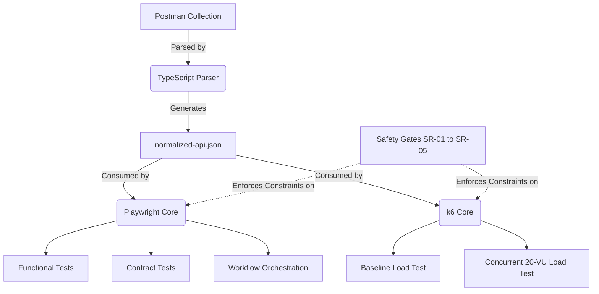

# 14 — Automation Architecture

**Phase:** Phase 6 (Architecture Decisions + Final Scaffold)  
**Date:** 2026-08-31

## Conceptual Model

To prevent tying our functional definitions to a single execution engine, the architecture relies on a **Language-Neutral Intermediate Model**.

## Directory Responsibilities

- `src/parser/`: Extracts endpoints, IDs, and auth strategies from Postman into the `normalized-api.json` artifact.
- `src/core/`: Contains the Playwright request wrapper, token cacher, and cleanup manager.
- `src/validation/`: Contains the JSON schema validators (implementing REQUIRED/OBSERVED rules).
- `src/config/`: Implements the SR-01 to SR-05 safety gate validation logic.
- `tests/`: Contains the Playwright specs.
- `load-tests/`: Contains the k6 `default function()` entrypoints mapping to Scenarios A, B, and C.

## Separation of Concerns
The Playwright execution context and the k6 execution context are 100% physically isolated. They share only the `normalized-api.json` blueprint. This prevents Node.js-specific modules (which k6 cannot natively run) from polluting the performance test scope.
